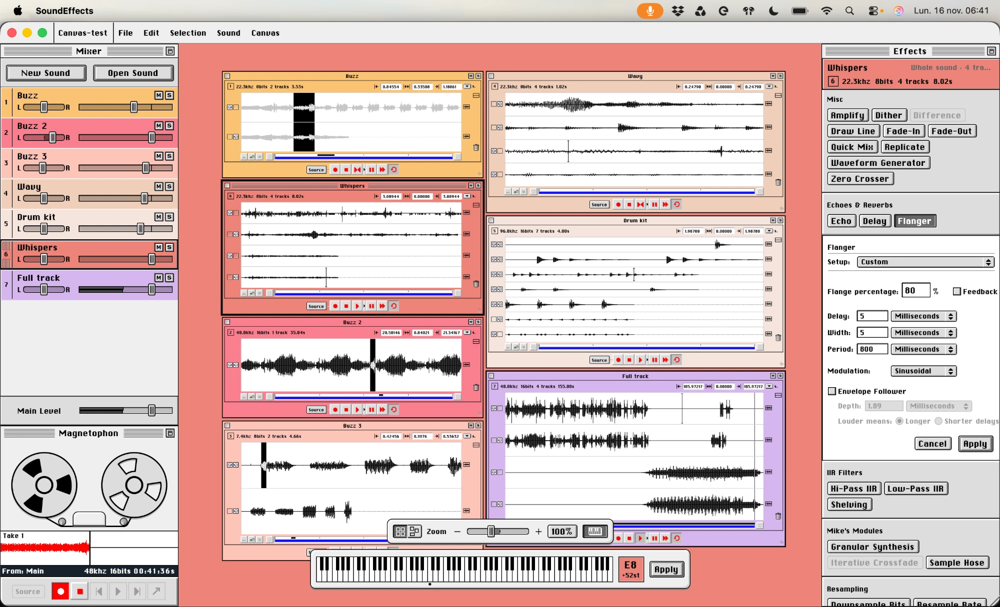

# SoundEffects

A rebuild of Alberto Ricci's **SoundEffects 0.9.2** (Macintosh, 1993–95), a
shareware destructive sound editor, as a native macOS app, reverse-engineered
from the original's resource fork, its Developer's Kit sources, and a
disassembly of its 68k code.

**Read the [user manual](docs/manual/index.html)** ([online](https://gthoreau.github.io/SoundEffects/manual/)).

It is not a clone of the original, but I wanted to recreate the inimitable personality
and the wonderfully creative flaws of the original, never finished, SoundEffects.
In SoundEffects every edit is destructive, there is no undo, channels are independent buffers of unequal
length, and the app talks to you in the first person. Where the 1995 app had a
quirk, this one has the same quirk on purpose.

What's new is the canvas: instead of one document at a time, every sound is a
window on an unbounded board, all of them summing at once — a bank of
unsynchronised loopers you arrange spatially.




---

## Download

**SoundEffects 0.5.0** — the app plus the **VST3** and **Audio Unit** plug-ins,
universal (Apple Silicon + Intel), macOS 11 Big Sur or later.

Download it from the
**[releases page](https://github.com/gthoreau/SoundEffects/releases/latest)**.
It comes one of two ways, and they install identically:

| | |
|---|---|
| `SoundEffects-0.5.0-macOS.dmg` | A disk image. Open it and drag the app into Applications; the plug-ins are in its `Plug-ins` folder. |
| `SoundEffects-0.5.0-macOS.zip` | The same in an archive, for when it came by email. Unzip, move the app into Applications. |

<details>
<summary>Why two formats?</summary>

Gmail refuses `.dmg` attachments — disk images are on its
[blocked file types list](https://support.google.com/mail/answer/6590), and
wrapping one in a `.zip` doesn't help because Gmail scans inside archives for the
same extensions. A zipped `.app` isn't on that list, so it goes through. The
`.dmg` is the nicer artifact everywhere else: file-sharing links, iMessage,
Signal, AirDrop.
</details>

If the app reaches you some other way (by email, say), the zip is the safe one:
see the note above.

### Installing

1. Put **SoundEffects** in your **Applications** folder — drag it out of the
   `.dmg`, or unzip the `.zip` and move it there.
2. Launch it. macOS will refuse, with *"Apple could not verify SoundEffects is
   free of malware."* **This is expected** — see below.
3. Open **System Settings → Privacy & Security**, scroll down to the Security
   section, and click **Open Anyway** next to SoundEffects. Confirm.

That's once, not every launch. It happens because the app is **not signed with an
Apple Developer ID and not notarized** — that costs $99/yr and this is a hobby
project — so macOS can't attach a name to it and blocks it by default.

<details>
<summary>On macOS 14 Sonoma or older</summary>

Right-click the app and choose **Open**, then **Open** again in the dialog. That
shortcut was removed in macOS 15 Sequoia, which is why the steps above go through
System Settings instead.
</details>

Prefer the command line? This clears the quarantine flag and skips the whole dance:

```bash
xattr -dr com.apple.quarantine /Applications/SoundEffects.app
```

### The plug-ins

The `Plug-ins` folder holds `SoundEffects.vst3` and `SoundEffects.component`
(Audio Unit). In the Finder, **Go → Go to Folder…** and copy:

| | |
|---|---|
| `SoundEffects.vst3` | into `~/Library/Audio/Plug-Ins/VST3` (create the folder if it is not there) |
| `SoundEffects.component` | into `~/Library/Audio/Plug-Ins/Components` |

Then restart your DAW or rescan its plug-ins. In Ableton Live, SoundEffects is
under **Plug-ins → SoundEffects**.
The whole app runs inside it: canvas, mixer, effects, recording from the DAW's
input. The canvas is saved with your set.

If an older `SoundEffects.vst3` is in `/Library/Audio/Plug-Ins/VST3` (the
computer-wide folder), replace or remove it, so the DAW does not find two. If the
plug-ins came from a download and the DAW won't load them, clear the quarantine
flag the same way:

```bash
xattr -dr com.apple.quarantine ~/Library/Audio/Plug-Ins/VST3/SoundEffects.vst3 ~/Library/Audio/Plug-Ins/Components/SoundEffects.component
```

---

## What works today

- **The canvas.** An unbounded board, zoom 20–400% (⌘/Ctrl + wheel, pinch, ⌘0,
  ⌘1), pan with a right-button drag or `H`, and a **grid** you drag windows
  between, or a **free** canvas (`G`) to place them anywhere.
- **The Mac OS 8 look.** Redrawn from a Figma design system and set in a
  recreated Classic Chicago, with 24 colour themes. Each sound wears one on its
  window and on its mixer strip.
- **Multiple tracks per window.** Each track is its own buffer with its own
  length, its own left/right speakers and its own loop, so tracks phase against
  each other and windows phase against each other. This is the point of the
  app. Drag tracks to reorder, add, duplicate (⌥-drag) or trash them.
- **A transport per window.** Record, stop, pause, play (`Space`), 2× and loop.
  Each window plays **Forward, Backward or Ping-pong** (`D`, or the strip on the
  Play button) and switches mid-play without a glitch. A running loop follows the
  selection as you change it.
- **Recording.** The **Source** button (⌘⇧R) records from an audio input, from
  the canvas (the main mix, or one window's own output) or, in a plugin, from
  the DAW. With nothing selected, a take goes into new tracks; with a selection
  over one or two tracks, it goes into the selection, as a punch-in or looping.
  Conversion is Raw (lo-fi, the default) or Clean.
- **The mixer.** One strip per window, in numbered slots (keys `1`…`0` select a
  slot). Each strip has a fader with a stereo VU meter, balance, mute and solo,
  and you drag strips to reorder them.
- **37 effects** in a panel, ported from the originals and checked against golden
  vectors generated from the TypeScript reference. They include Amplify,
  Echo/Delay, Flanger, the FIR and IIR filters, Robotize, Granular Synthesis,
  Sample Hose, Weird Tempo and Zero Crosser. Settings open in a tray, setups
  (presets) are saved and recalled, and **Auto-apply** makes the one-click
  effects instant.
- **The original's editing.** Cut, copy, paste, duplicate, clear, crop, insert
  silence, Leave Silence, Shift Sound, Select Exactly, Select Peak, Select Silence
  and Set Loop, all from the in-app **Edit** and **Selection** menus. The
  selection's start, length and end are live fields in seconds, ms or samples.
- **The Keyboard.** A palette that plays the selected window at chromatic pitches
  (`K`). **MIDI plays it**: a keyboard such as a KeyStep, and **MPE** controllers
  (Push 3, LinnStrument) whose per-note pitch slide bends the sound continuously.
  It is mono, the last note played sounding. In the app, tick your device in
  **Audio/Midi Setup**; in the plug-ins the DAW's MIDI plays it, window open or not.
- **The Magnetophon.** A reel-to-reel tape recorder under the mixer. It records
  the main mix, one window's output, an input or the DAW into takes, plays them
  back (drag the tape to wind it by hand), and **Send** puts the whole tape, or
  chosen takes, on the canvas as new sounds. The tape lives for the session.
- **Main Level.** One fader for the whole canvas, saved with it.
- **Colour theme.** **Canvas → Hide Color Theme** swaps every colour for a sober
  Mac OS 8 grey.
- **Projects.** **Save Canvas** (⌘S) writes a folder holding the `.sefx` file and
  an `Assets` folder with every track as a WAV. **Export Sound** and **Import
  Sound** move single sounds between canvases. **Open Sound** (⌘O) reads WAV and
  AIFF; a stereo file arrives as two tracks routed left and right.

## What doesn't work yet

Worth knowing before you spend an evening on a patch:

- **There is no undo**, and there never will be. That one is deliberate: the
  menu item is there and always greyed. See the original's own alert text in the
  spec.
- **The plug-in's MPE** reaches the Audio Unit; the VST3 wrapper has no
  note-expression support yet, so try the AU for a pitch slide from a DAW.
- **The Magnetophon's tape is not saved**: use **Send** to keep it. Closing a
  canvas warns while takes are unsent.
- **The canvas is only saved when you ask, or when you quit.** A crash loses what
  you did since the last ⌘S.
- **Not back yet from the original:** the Preferences pages, the level meter,
  Spectrum, the Chunk List and Play Clipboard.

## Requirements

macOS 11 Big Sur or later, Apple Silicon or Intel. No installer beyond the drag.
It leaves two files on your disk:

- `~/Library/Application Support/SoundEffects.settings` holds your audio device
  choice and the canvas you had open when you last quit. That file therefore
  carries your audio and can run to tens of megabytes once you have real samples
  loaded. It is rewritten on every quit.
- `~/Library/Application Support/SoundEffects/Preferences.settings` holds the
  app's preferences: the selection unit, Auto-apply and the effect setups.

Delete the app and those two and nothing remains.

If you ran an earlier build, back when the app was called SoundEffect without the
s, there is also a `SoundEffect.settings` next to it. The first launch under the
new name copies it across, so your canvas and audio device come with you; the old
file is then dead weight and safe to delete.

Audio input and output are picked in **File → Audio/Midi Setup** (⌘,).

---

## Building it yourself

Needs CMake ≥ 3.22, Ninja, and the Xcode Command Line Tools. JUCE is fetched
automatically at configure time.

```bash
./native/packaging/package.sh
```

That configures a universal Release build, builds the standalone app and the
VST3 and AU plug-ins, signs them ad-hoc, and writes both `SoundEffects-<version>-macOS.dmg` and `.zip` into
`native/dist/`. Pass `--dmg` or `--zip` for just one. The version comes from
`project(SoundEffects VERSION …)` in [native/CMakeLists.txt](native/CMakeLists.txt) — bump it there and the
script and both filenames follow.

The archive is made with `ditto -c -k --keepParent`, not `zip`: an `.app` is a
bundle of symlinks and exec bits, and plain `zip` flattens the symlinks, so the
unpacked app won't launch.

For a plain development build (Debug, host architecture only):

```bash
cmake -B native/build -S native -G Ninja && cmake --build native/build
```

The plug-ins are the `SoundEffects_VST3` and `SoundEffects_AU` targets of the
same build.

The 0.5.0 work, its decisions and its journal are in
[docs/0.5.0/PLAN.md](docs/0.5.0/PLAN.md); the 0.4.0 work is in
[docs/0.4.0/PLAN.md](docs/0.4.0/PLAN.md), and what comes next is in
[docs/0.4.0/perf-audit-plan.md](docs/0.4.0/perf-audit-plan.md).

## Repository layout

| | |
|---|---|
| [`native/`](native/) | The macOS app — JUCE UI over a host-agnostic C++ engine. [Its README](native/README.md) is the detailed design document. |
| [`src/`](src/) | The TypeScript reference implementation: the byte-accurate model, effects and file formats the C++ is ported from and tested against. |
| [`SoundEffects-0.9.2-SPEC.md`](SoundEffects-0.9.2-SPEC.md) | The reconstruction spec, reverse-engineered from the original. |
| [`disassembly/`](disassembly/) | Notes from the 68k disassembly, for behaviour no document pinned down. |
| [`tools/`](tools/) | Resource extraction and golden-vector generation. |

Running the reference test suite:

```bash
npm install && npm run check
```

## Credits

*SoundEffects* was written by **Alberto Ricci** (Torino, 1993–95) and released as
$15 shareware. This project is an independent reconstruction, built for the love
of it. The About box of the original credits "pizza by: Mommy" and "manual by: No
manual, folks!" — a standard this one has yet to meet.
