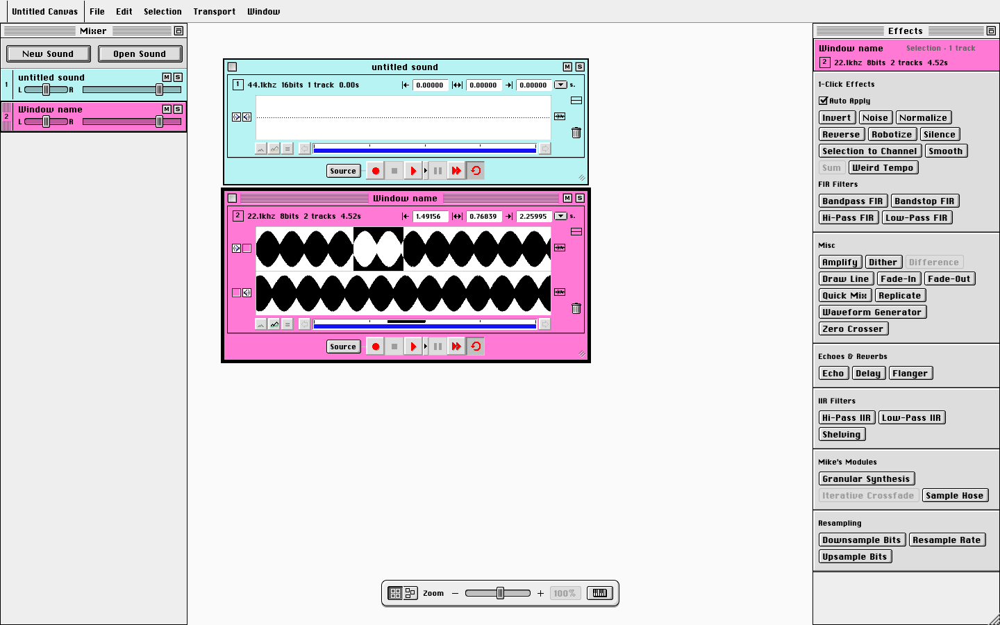

# SoundEffect

A rebuild of Alberto Ricci's **SoundEffects 0.9.2** (Macintosh, 1993–95) — the
shareware destructive sound editor — as a native macOS app, reverse-engineered
from the original's resource fork, its Developer's Kit sources, and a
disassembly of its 68k code.

It is not a nostalgia skin. The original's personality *is* the spec: every edit
is destructive, there is no undo, channels are independent buffers of unequal
length, and the app talks to you in the first person. Where the 1995 app had a
quirk, this one has the same quirk on purpose.

What's new is the canvas: instead of one document at a time, every sound is a
window on an unbounded board, all of them summing at once — a bank of
unsynchronised loopers you arrange spatially.



---

## Download

**SoundEffect 0.2.0** — universal (Apple Silicon + Intel), macOS 11 Big Sur or
later, about 4.6 MB.

This repository is private, so there's no public download page. **The app is
handed out directly — ask me and I'll send it.** It arrives one of two ways, and
they install identically:

| | |
|---|---|
| `SoundEffect-0.2.0-macOS.dmg` | A disk image. Open it and drag the app into Applications. |
| `SoundEffect-0.2.0-macOS.zip` | The app in an archive, for when it came by email. Unzip and move the app into Applications. |

<details>
<summary>Why two formats?</summary>

Gmail refuses `.dmg` attachments — disk images are on its
[blocked file types list](https://support.google.com/mail/answer/6590), and
wrapping one in a `.zip` doesn't help because Gmail scans inside archives for the
same extensions. A zipped `.app` isn't on that list, so it goes through. The
`.dmg` is the nicer artifact everywhere else: file-sharing links, iMessage,
Signal, AirDrop.
</details>

If you have access to this repository, releases are also attached to
[github.com/gthoreau/SoundEffects/releases](https://github.com/gthoreau/SoundEffects/releases).

### Installing

1. Put **SoundEffect** in your **Applications** folder — drag it out of the
   `.dmg`, or unzip the `.zip` and move it there.
2. Launch it. macOS will refuse, with *"Apple could not verify SoundEffect is
   free of malware."* **This is expected** — see below.
3. Open **System Settings → Privacy & Security**, scroll down to the Security
   section, and click **Open Anyway** next to SoundEffect. Confirm.

That's once, not every launch. It happens because the app is **not signed with an
Apple Developer ID and not notarized** — that costs $99/yr and this is a hobby
project — so macOS can't attach a name to it and blocks it by default.

<details>
<summary>On macOS 14 Sonoma or older</summary>

Right-click the app and choose **Open**, then **Open** again in the dialog. That
shortcut was removed in macOS 15 Sequoia, which is why the steps above go through
System Settings instead.
</details>

Prefer the command line? This clears the quarantine flag and skips the whole dance:

```bash
xattr -dr com.apple.quarantine /Applications/SoundEffect.app
```

---

## What works today

- **The canvas** — unbounded board, zoom 20–400% (⌘/Ctrl + wheel or pinch), pan
  (`H`), snap-to-grid columns you can drag windows between, or **Mosaic** to turn
  the grid off and place them freely.
- **Open WAV and AIFF** (⌘O). A stereo file arrives as two tracks already routed
  left and right.
- **Multiple tracks per window**, each its own buffer with its own length, its own
  `L` / `L+R` / `R` output routing, and its own loop — so tracks phase against
  each other, and windows phase against each other. This is the point of the app.
- **Transport per window** — play/pause (also `Space`), stop, 2× and loop.
- **The mixer** — one strip per window, with mute, solo, a dB fader and a VU meter
  sharing one trough on one scale.
- **37 effects**, ported from the originals and checked against golden vectors
  generated from the TypeScript reference — Amplify, Echo/Delay, Flanger, FIR and
  IIR filters, Robotize, Granular Synthesis, Sample Hose, Weird Tempo, Zero
  Crosser and the rest.

## What doesn't work yet

Worth knowing before you spend an evening on a patch:

- **There is no Export.** Your work is safe — see Save Current State above — but
  it can only be reopened by SoundEffect. Nothing leaves as a WAV or AIFF yet, so
  recording the output with Loopback/BlackHole is still the only way into another
  program.
- **Recording is not wired up.** The red button is there; pressing it opens the
  audio settings and otherwise does nothing.
- **There is no undo** — and there never will be. That one is deliberate; see the
  original's own alert text in the spec.
- **Saving your work.** **Options → "Save Current State…"** writes the whole
  canvas to a file — every window where you left it, its colour, its tracks and
  their audio, and the mixer settings — and **"Load a Saved State…"** brings it
  back. You don't have to remember to: quit and the canvas is waiting on the next
  launch. (It comes back stopped, not playing.)

## Requirements

macOS 11 Big Sur or later, Apple Silicon or Intel. No installer beyond the drag.
The only thing it leaves on your disk is
`~/Library/Application Support/SoundEffect.settings` — your audio device choice,
and the canvas you had open when you last quit. That file therefore carries your
audio, and can run to tens of megabytes once you have real samples loaded; it is
rewritten on every quit. Delete the app and that file and nothing remains.

Audio input/output is picked in the **Options → Audio/MIDI Settings** menu.

---

## Building it yourself

Needs CMake ≥ 3.22, Ninja, and the Xcode Command Line Tools. JUCE is fetched
automatically at configure time.

```bash
./native/packaging/package.sh
```

That configures a universal Release build, builds the standalone app, signs it
ad-hoc, and writes both `SoundEffect-<version>-macOS.dmg` and `.zip` into
`native/dist/`. Pass `--dmg` or `--zip` for just one. The version comes from
`project(SoundEffect VERSION …)` in [native/CMakeLists.txt](native/CMakeLists.txt) — bump it there and the
script and both filenames follow.

The archive is made with `ditto -c -k --keepParent`, not `zip`: an `.app` is a
bundle of symlinks and exec bits, and plain `zip` flattens the symlinks, so the
unpacked app won't launch.

For a plain development build (Debug, host architecture only):

```bash
cmake -B native/build -S native -G Ninja && cmake --build native/build
```

The same sources also build a **VST3** and an **AU** plugin (`SoundEffect_VST3`,
`SoundEffect_AU`); only the standalone app is packaged for release today.

## Repository layout

| | |
|---|---|
| [`native/`](native/) | The macOS app — JUCE UI over a host-agnostic C++ engine. [Its README](native/README.md) is the detailed design document. |
| [`src/`](src/) | The TypeScript reference implementation: the byte-accurate model, effects and file formats the C++ is ported from and tested against. |
| [`SoundEffects-0.9.2-SPEC.md`](SoundEffects-0.9.2-SPEC.md) | The reconstruction spec, reverse-engineered from the original. |
| [`disassembly/`](disassembly/) | Notes from the 68k disassembly, for behaviour no document pinned down. |
| [`tools/`](tools/) | Resource extraction and golden-vector generation. |

Running the reference test suite:

```bash
npm install && npm run check
```

## Credits

*SoundEffects* was written by **Alberto Ricci** (Torino, 1993–95) and released as
$15 shareware. This project is an independent reconstruction, built for the love
of it. The About box of the original credits "pizza by: Mommy" and "manual by: No
manual, folks!" — a standard this one has yet to meet.
